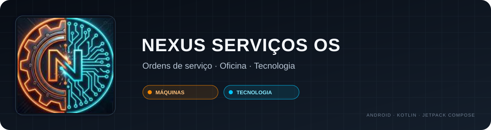
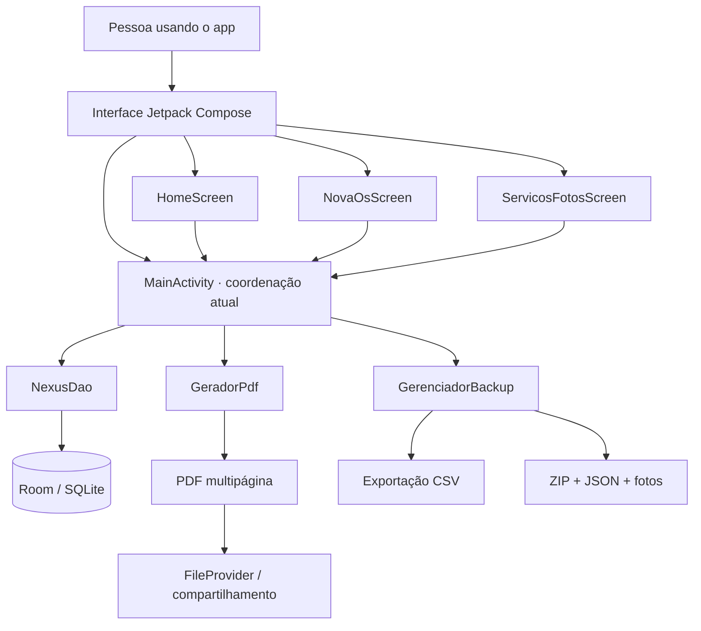
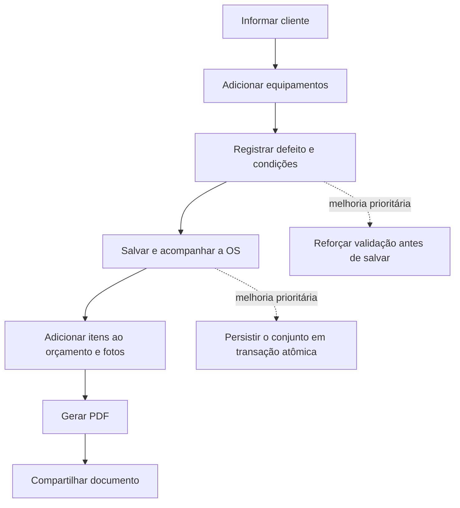

<div align="center">
  
  <p><strong>Um aplicativo Android para organizar o atendimento de uma oficina de máquinas e tecnologia.</strong></p>
  <p>
    
    
    
    
    
  </p>
  <p><em>Versão 1.0 · Projeto de portfólio · Em evolução</em></p>
</div>

## Sobre o projeto

O **Nexus Serviços OS** é um aplicativo Android nativo criado para organizar o fluxo de uma oficina que atende equipamentos mecânicos — como motosserras, roçadeiras, cortadores de grama, geradores e compressores — e itens de tecnologia, como computadores, notebooks e celulares.

A ideia nasceu de uma necessidade prática: manter os dados do cliente, os equipamentos recebidos, o diagnóstico, o orçamento, as fotos e o documento de atendimento organizados em um único fluxo, com armazenamento local para o uso cotidiano da oficina.

> **Estado atual:** esta é a V1 funcional usada como base para demonstração e evolução. Ainda existem riscos de lógica e integridade de dados documentados neste repositório. Não a trate como um sistema auditado para produção nem use a rotina de limpeza da demonstração com dados reais.

## O que a V1 já contempla

- **Clientes:** cadastro com nome, telefones e endereço, além de busca/sugestão de clientes já cadastrados.
- **Ordens de serviço:** estrutura para uma OS conter vários equipamentos, cada um com identificação e informações de atendimento.
- **Status por equipamento:** acompanhamento individual e consolidação de status para a ordem.
- **Orçamento:** itens de peças/serviços, quantidades, desconto e cálculo central com valores em centavos para reduzir erros de arredondamento.
- **Registro fotográfico:** associação de fotos ao número sequencial do equipamento e distinção por tipo de foto.
- **PDF multipágina:** documento gerado com APIs nativas do Android, incluindo resumo, equipamentos, itens e anexos fotográficos.
- **Compartilhamento:** uso de `Intent` e `FileProvider` para compartilhar arquivos pelo próprio Android.
- **Exportação e backup local:** CSV e ZIP com JSON estruturado e fotos, além de fluxo de restauração.
- **Persistência local:** Room sobre SQLite; a versão do esquema declarada no código é 6.
- **Identidade visual:** tema escuro industrial, com laranja para máquinas e ciano para tecnologia.

As funcionalidades listadas foram verificadas por inspeção do código-fonte. Existem testes no projeto, mas a suíte completa não foi executada durante a preparação deste repositório.

## Tecnologias e configuração

| Camada | Implementação encontrada no projeto |
|---|---|
| Linguagem | Kotlin 2.2.10 |
| Interface | Jetpack Compose + Material 3 |
| Banco local | Room 2.8.5 / SQLite |
| Assincronismo | Kotlin Coroutines, `lifecycleScope`, `Dispatchers.IO` |
| Documento | `PdfDocument` nativo + Canvas |
| Arquivos | APIs Android, `FileProvider`, CSV, JSON e ZIP |
| Build | Android Gradle Plugin 9.4.1 + Gradle Wrapper 9.6.0 |
| SDK | `compileSdk 34`, `targetSdk 34`, `minSdk 24` |
| Testes presentes | JUnit 4 e AndroidX instrumented tests |

O projeto contém `gradle/gradle-daemon-jvm.properties` configurando Java 25 para o daemon Gradle. Valide essa configuração em um clone limpo; a documentação do AGP 9.4 lista JDK 17 como versão mínima/padrão. Veja as [notas oficiais de compatibilidade do AGP](https://developer.android.com/build/releases/agp-9-4-0-release-notes).

## Arquitetura observada



O diagrama descreve a estrutura encontrada, não uma arquitetura idealizada. A coordenação de fluxos e parte da lógica estão concentradas em `MainActivity`; extrair responsabilidades para componentes menores e testáveis é uma das melhorias planejadas.

### Fluxo simplificado de atendimento



## Demonstração visual

<div align="center">
  
  <p><em>Arte incluída no projeto. Capturas reais das telas serão acrescentadas após serem obtidas de uma execução limpa, sem dados pessoais.</em></p>
</div>

## Como abrir e executar

1. Instale uma versão do Android Studio compatível com o Android Gradle Plugin 9.4.1 e tenha o Android SDK Platform 34 disponível.
2. Clone o repositório e abra a pasta raiz no Android Studio.
3. Aguarde o Gradle Sync. Não copie `local.properties` de outra máquina: esse arquivo contém caminhos locais e deve ser gerado pelo Android Studio.
4. Se o sync concluir, execute o app em um emulador ou dispositivo de teste.

Com o SDK configurado, os comandos esperados para compilar e executar os testes de unidade são:

```bash
./gradlew :app:assembleDebug
./gradlew :app:testDebugUnitTest
```

No Windows, use `gradlew.bat` em vez de `./gradlew`. Esses comandos estão documentados para reprodução, mas **não foram validados neste ambiente de preparação** porque aqui não há Android SDK instalado. O arquivo ZIP original continha artefatos de build locais, que foram removidos do repositório para não versionar resultados gerados.

## Limitações conhecidas e próximos passos

A revisão do código completo identificou riscos que precisam ser tratados. A lista detalhada está em [`docs/STATUS-E-LIMITACOES.md`](docs/STATUS-E-LIMITACOES.md), e as tarefas estão priorizadas em [`docs/ROADMAP.md`](docs/ROADMAP.md).

Prioridades imediatas:

1. **Corrigir a limpeza da demonstração:** no código publicado, o callback atual apaga registros de tabelas inteiras, e não apenas a OS de demonstração.
2. **Validar campos obrigatórios:** o fluxo atual ainda permite que dados incompletos avancem até o salvamento; existe um fallback para “Cliente sem nome”.
3. **Usar transações atômicas:** edição de OS e restauração do backup fazem múltiplas operações sem uma única transação abrangente.
4. **Testar restauração e falhas parciais:** validar os arquivos antes de substituir dados existentes e cobrir falhas com testes.
5. **Extrair regras de negócio da UI:** facilitar manutenção, legibilidade e testes.
6. **Adicionar screenshots reais e pipeline de CI:** depois de confirmar a compilação e estabilizar os fluxos críticos.

## Transparência sobre IA e minha contribuição

Este projeto foi desenvolvido com **uso intensivo de ferramentas de inteligência artificial generativa**. Não afirmo que escrevi manualmente todo o código nem que a implementação foi feita sem assistência.

Minha contribuição foi atuar como responsável pelo produto: identifiquei a necessidade da oficina, defini o escopo e os comportamentos desejados, conduzi as iterações com a IA, organizei e integrei os arquivos, avaliei o aplicativo e comecei a transformar inconsistências encontradas em tarefas de evolução. A IA realizou grande parte da implementação do código; eu conduzi a direção do projeto e assumo o compromisso de compreender, testar e melhorar o resultado.

Este repositório documenta tanto o que já foi construído quanto o que ainda precisa ser aprendido, testado e corrigido. A intenção é evoluir a V1 de forma incremental, usando decisões verificáveis em vez de esconder as limitações.

Para uma explicação mais detalhada, consulte [`docs/CONTRIBUICAO-E-IA.md`](docs/CONTRIBUICAO-E-IA.md).

## Privacidade e dados de demonstração

- Este repositório contém apenas código, configurações de build e recursos da aplicação; não inclua dados reais de clientes, banco local, fotos, PDFs ou backups.
- O número de WhatsApp que existia como padrão no código foi removido desta cópia de portfólio. Configure o contato correto nas configurações da oficina dentro do app.
- Os dados usados pelo recurso de demonstração devem ser tratados como dados ilustrativos. Antes de usar a demonstração, considere o risco descrito no status técnico.
- `local.properties`, chaves de assinatura, credenciais e saídas de build são excluídos pelo `.gitignore`.

## Licença

Nenhuma licença foi definida nesta V1. Até que uma licença seja escolhida e adicionada, não presuma que o repositório concede permissão para reutilizar ou redistribuir o código.

## Sobre

**Projeto:** Nexus Serviços OS  
**Responsável pelo produto e condução das iterações:** Nathan Santos Peres  
**Plataforma:** Android nativo · Kotlin · Jetpack Compose
